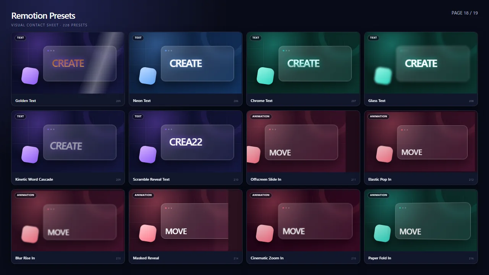

# remotion-presets

[](https://github.com/LilMzki/remotion-presets/actions/workflows/ci.yml)
[](https://github.com/LilMzki/remotion-presets/actions/workflows/visual-render.yml)
[](LICENSE)

Remotionで「何フレーム目に座標をいくつ動かすか」ではなく、「タイプライターで表示する」「黄金の文字にする」「ウィップで場面をつなぐ」といった**編集意図**を指定するための高レベル・プリセットライブラリです。

Adobe Premiere Pro 26.0の映像エフェクト／トランジションを機能上の参照点としつつ、Reactコンポーネント、Remotion Effects、`TransitionSeries`互換presentationとして扱えるAPIを提供します。さらに、文字・登場演出・映像ルックを組み合わせた独自の複合プリセットも収録しています。



<p align="center">全228プリセットを12件ずつ確認できる、同梱Remotion Studioのコンタクトシート</p>

> [!IMPORTANT]
> 現在はGitHubから利用する開発版です。`remotion-presets`という名前ではnpmへ公開していません。出所不明の同名npmパッケージをインストールしないでください。

## 収録内容

| 区分             |    件数 | 内容                                                                         |
| ---------------- | ------: | ---------------------------------------------------------------------------- |
| Premiere Current |     171 | Premiere Pro 26.0の現行映像エフェクト、アニメーション、映像トランジション    |
| Premiere Legacy  |      33 | 旧版の映像エフェクト／映像トランジション。現行版と別IDで保持                 |
| Compound         |      24 | 文字、登場演出、映像ルック、編集演出を組み合わせた独自プリセット             |
| **合計**         | **228** | 全項目に安定したID、日本語説明、既定値、調整項目、描画方式のメタデータを付与 |

全名称と対応状況は[Premiere対応表](docs/premiere-coverage.md)で確認できます。v0.1.0では、Premiere参照204件を共有engine／familyによる利用可能な近似として提供し、すべて`approximate`と明記しています。今後、専用アルゴリズムと視覚検証がそろった項目だけを`equivalent`へ昇格します。段階ごとの完了条件は[ロードマップ](docs/roadmap.md)で公開しています。

## 特長

- **意図をそのまま記述** — `TypewriterText`、`GoldenText`、`OffscreenSlideIn`などをReactコンポーネントとして利用できます。
- **Remotionの標準APIへ接続** — 映像処理は`effects`、トランジションは`TransitionSeries`へ渡せます。
- **検索可能な台帳** — 228件をID、種類、日英名称、タグ、Premiereカテゴリから検索できます。
- **決定的なレンダリング** — ノイズや揺れを含むプリセットは`seed`で固定できます。
- **用途別のsubpath export** — `text`、`effects`、`transitions`など、importの意図をカテゴリ単位で明確にできます。
- **確認用カタログを同梱** — Remotion Studioで全プリセット、単体プレビュー、12件ずつのコンタクトシートを確認できます。

## 必要環境

- Node.js 20.17以上
- Remotion `4.0.515`（このバージョンで検証）
- React 18または19

パッケージのpeer dependencyは`remotion`と`@remotion/transitions`の`4.0.515`、React／React DOMの18または19です。利用側でほかの`@remotion/*`を追加するときも、すべて`4.0.515`にそろえてください。

上記はライブラリ利用側の要件です。このリポジトリをcloneして開発・検証する場合は、固定済みの開発ツールに合わせてNode.js 20.19以上、22.13以上、または24以上を使用してください。

## GitHubから導入する

このリポジトリはnpm workspaceなので、現時点ではcloneして生成したtarballをアプリへ追加する方法を推奨します。

```bash
git clone https://github.com/LilMzki/remotion-presets.git
cd remotion-presets
npm ci
npm run build
npm pack --workspace remotion-presets
```

続いて、利用側のRemotionプロジェクトで、生成された`remotion-presets-0.1.0.tgz`を指定します。

```bash
npm install /absolute/path/to/remotion-presets/remotion-presets-0.1.0.tgz
npm install --save-exact remotion@4.0.515 @remotion/transitions@4.0.515
# <Video>へeffectを渡す例を使う場合
npm install --save-exact @remotion/media@4.0.515
```

より詳しい手順とローカル開発時の参照方法は[はじめに](docs/getting-started.md)を参照してください。

## 最短の使用例

### タイプライターと黄金の文字

```tsx
import { AbsoluteFill, Sequence } from 'remotion';
import { GoldenText, TypewriterText } from 'remotion-presets/text';

export const Title: React.FC = () => (
  <AbsoluteFill style={{ backgroundColor: '#080808', color: 'white' }}>
    <Sequence durationInFrames={50}>
      <TypewriterText
        text="物語が、動き出す。"
        durationInFrames={45}
        style={{ fontSize: 72, fontWeight: 700 }}
      />
    </Sequence>
    <Sequence from={50}>
      <GoldenText
        text="PREMIERE NIGHT"
        intensity={1.15}
        style={{ fontSize: 108, fontWeight: 900 }}
      />
    </Sequence>
  </AbsoluteFill>
);
```

どちらも内部では画面全体を覆うレイヤーです。複数を同時に置く場合は、この例のように`Sequence`やラッパー要素で表示時間と配置を決めてください。

### 画面外から登場させる

```tsx
import { OffscreenSlideIn } from 'remotion-presets/animations';

export const LowerThird: React.FC = () => (
  <OffscreenSlideIn direction="left" durationInFrames={24} intensity={0.9}>
    <div style={{ position: 'absolute', left: 80, bottom: 80, fontSize: 54 }}>
      山田 花子 — Creative Director
    </div>
  </OffscreenSlideIn>
);
```

### 映像へプリセット効果を適用する

```tsx
import { Video } from '@remotion/media';
import { staticFile } from 'remotion';
import { usePresetEffect } from 'remotion-presets/effects';

export const FilmShot: React.FC = () => {
  const vintage = usePresetEffect('vintage-film', {
    intensity: 0.8,
    seed: 'scene-07',
  });

  return (
    <Video
      src={staticFile('shot.mp4')}
      effects={[...vintage.effects]}
      style={vintage.fallbackStyle}
    />
  );
};
```

`usePresetEffect()`は現在frameとfpsを取り込み、`effects`配列とCSSの簡易表現である`fallbackStyle`を返します。camera shake、noise、VHS、vintage filmなど時間変化する演出にはhookを使います。ビネットや固定色調など静的なルックは、コンポーネント外でも呼べる`createPresetEffect()`で作れます。どちらの`effects`も`<Video>`、``、`<HtmlInCanvas>`などの対応コンポーネントへ渡せます。

### トランジションを組む

```tsx
import { linearTiming, TransitionSeries } from '@remotion/transitions';
import { createPresetTransition } from 'remotion-presets/transitions';

const whip = createPresetTransition('whip', {
  direction: 'left',
  intensity: 1.1,
});

export const Edit: React.FC = () => (
  <TransitionSeries>
    <TransitionSeries.Sequence durationInFrames={90}>
      <SceneA />
    </TransitionSeries.Sequence>
    <TransitionSeries.Transition
      presentation={whip}
      timing={linearTiming({ durationInFrames: 18 })}
    />
    <TransitionSeries.Sequence durationInFrames={90}>
      <SceneB />
    </TransitionSeries.Sequence>
  </TransitionSeries>
);
```

presentationと長さを一緒に作りたい場合は`createTransitionSpec('whip', {durationInFrames: 18})`を使えます。名前付きの`whip()`、`crossDissolve()`なども`{presentation, timing}`を返します。

公開APIの全体像、共通オプション、台帳の検索方法は[APIガイド](docs/api.md)にまとめています。

## カタログを開く

```bash
git clone https://github.com/LilMzki/remotion-presets.git
cd remotion-presets
npm ci
npm run dev
```

Remotion Studioで次のcompositionを選べます。

- `PresetCatalog` — 228件を順番に再生
- `Review/PresetContactSheet` — 12件ずつ一覧表示（`page`で切り替え）
- `Review/PresetSingle` — `presetId`を指定して単体確認
- `Review/CanvasEffectSingle` — effects APIのCanvas処理を`presetId`ごとに確認

MP4のカタログを書き出す場合は`npm run render:catalog --workspace @remotion-presets/studio`を実行します。

## ブラウザとレンダリング上の注意

`<Video>`や``へプリセットeffectを渡す通常の使い方に、特別なChromeフラグは不要です。Chrome 149以降と`chrome://flags/#canvas-draw-element`が必要なのは、任意のDOMを実験的な`<HtmlInCanvas>`でCanvas化してStudioプレビューする場合だけです。`<HtmlInCanvas>`の入れ子はできません。同梱Studioでは`CanvasEffectSingle`だけがこの経路を使います。

静的／時間変化effectの使い分け、Studio compositionごとの要件は[ブラウザとレンダリング](docs/browser-and-rendering.md)を参照してください。

## ライセンスと商標

このリポジトリで独自に実装したコードは[MIT License](LICENSE)です。一方、実行に必要なRemotionおよび`@remotion/*`は本ライブラリのMIT対象ではなく、利用者の属性や用途に応じたRemotion独自のライセンス条件が適用されます。利用前に[Remotion License](https://github.com/remotion-dev/remotion/blob/main/LICENSE.md)を必ず確認してください。詳細は[ライセンスについて](docs/licensing.md)に記載しています。

本プロジェクトはAdobe、Premiere Pro、Remotionの公式プロジェクトではなく、各社との提携・承認関係もありません。Adobe、Adobe Premiere、Premiere ProはAdobeの商標または登録商標です。名称は互換性と機能対応を説明する目的でのみ使用しています。Adobe製品のコード、UI、プリセットファイル、画像・音声素材は同梱していません。

## 開発

```bash
npm ci
npm run validate
```

IssueやPull Requestを歓迎します。新しいプリセットは、安定したID、日本語メタデータ、決定的な出力、既定値で成立するプレビュー、テストをそろえてください。

## ドキュメント

- [はじめに](docs/getting-started.md)
- [APIガイド](docs/api.md)
- [Premiere対応表（全228件）](docs/premiere-coverage.md)
- [ロードマップ](docs/roadmap.md)
- [ブラウザとレンダリング](docs/browser-and-rendering.md)
- [ライセンスについて](docs/licensing.md)
- [変更履歴](CHANGELOG.md)
